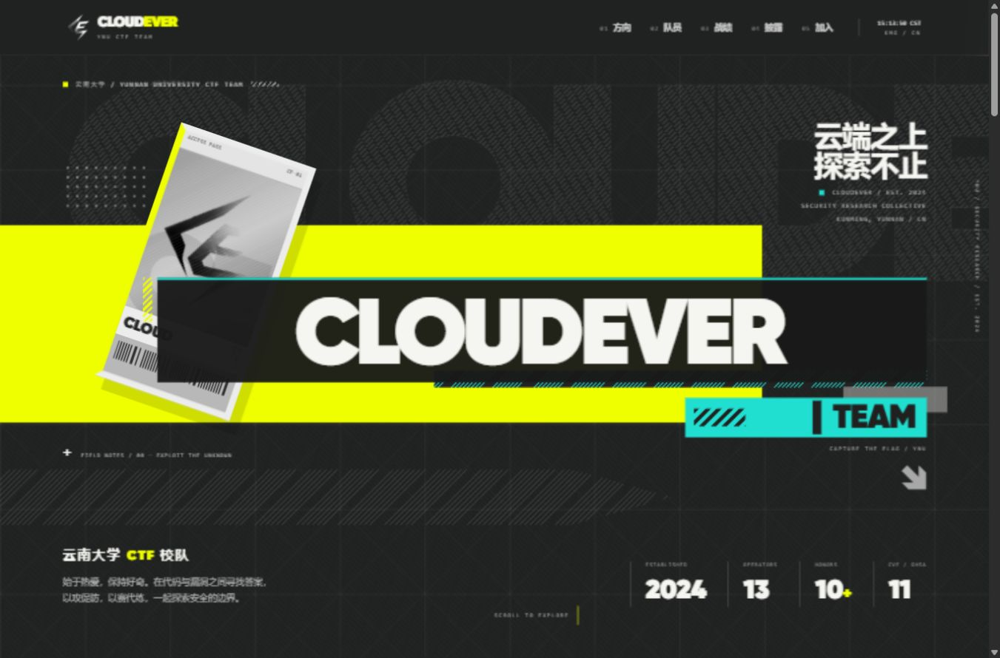

# CloudEver CTF 战队官网

云南大学 CTF 校队，成立于 2024 年，专注于网络安全研究、漏洞分析与 CTF 赛事。

官网地址：[cloudever.top](https://cloudever.top)

## 视觉与内容

首页参考提供的工业风长图重新设计，采用深灰网格与细斜纹背景、荧光黄横向色带、超大白色 CLOUDEVER 字标、青色 TEAM 标签，以及带有战队 Logo 的倾斜证件标签。

- **方向 / TECHNICAL FOCUS**：PWN、Web、Reverse、Misc 四个技术方向，战队简介与交互终端。
- **队员 / TEAM COMPOSITION**：13 名队员的档案卡、个人主页、方向和去向；悬停或键盘聚焦时头像恢复彩色。
- **战绩 / HONOR RECORD**：8 页赛事记录，保留 10 项荣誉，支持按钮、方向键、Home / End 和触屏滑动。
- **披露 / SECURITY RESEARCH**：保留 11 项 CVE / GHSA 公开披露。
- **加入 / RECRUITMENT**：招新说明、QQ群弹窗和邮件入口。

桌面为四列成员卡，平板为三列，手机为双列；手机导航折叠。所有字体、头像与封面素材均为本地资源。

## 首页预览



## 本地运行

在本目录启动静态服务器：

```powershell
python -m http.server 8000 --bind 127.0.0.1
```

访问 [http://127.0.0.1:8000](http://127.0.0.1:8000)。无需安装依赖或编译，可直接部署到静态托管服务。

## 交互终端

输入 `help` 查看命令。输入 `linux` 启动浏览器内的 `v86 + WebAssembly` Linux 环境，输入 `exit-linux` 返回战队 shell。

运行时由本地 `assets/v86/` 提供，包括 `v86.wasm`、BIOS、VGA BIOS 与内核镜像。Linux 功能需要通过 HTTP / HTTPS 访问页面。

## 目录

```text
cloudever.top/
├── index.html          # 首页内容与分区
├── css/endfield.css    # 当前工业风主题与响应式布局
├── css/infographic.css # 保留的旧版布局
├── css/paper.css       # 保留的旧版纸面主题
├── images/             # 战队标志、队员头像和预览
├── webfonts/           # 本地字体
├── js/team.js          # 队员、荣誉翻页、终端和加入弹窗
├── js/hud.js           # 导航高亮、滚动进度和时钟
└── assets/v86/         # Linux 运行时
```

同级 `rahoo-infographic/` 为参考长图的独立前端镜像，未作为官网运行依赖。

© 2025–2026 CloudEver Team.
